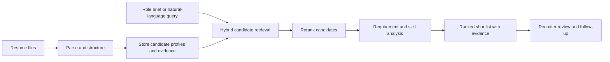
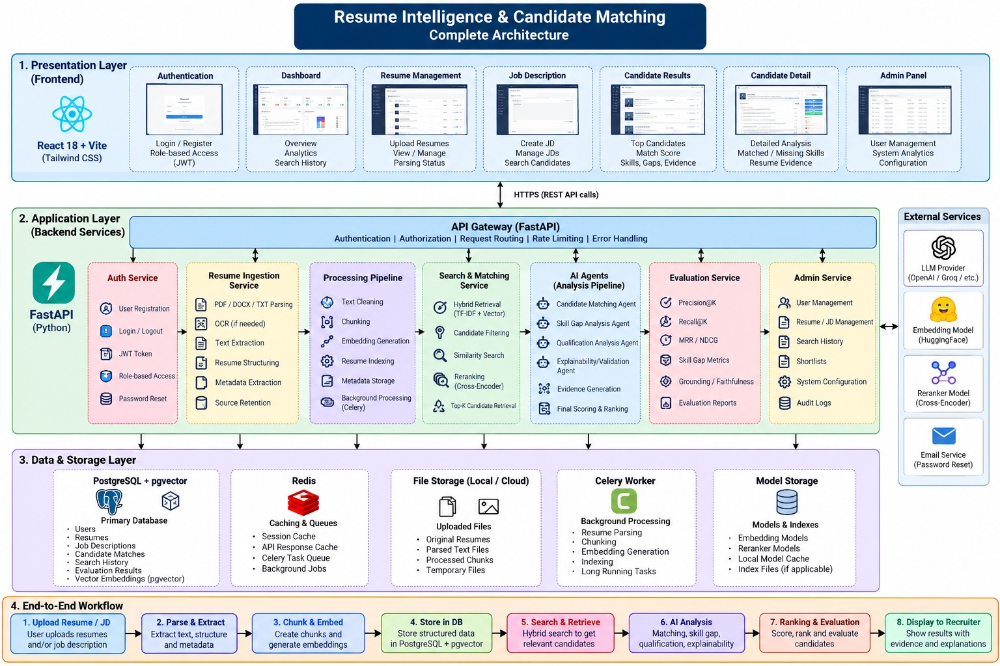

<div align="center">

# Resume Intelligence

### Evidence-grounded talent search for modern recruiting teams

Find relevant candidates across a resume library, understand why they match, and keep recruiting work organized in one HR workspace.

<br />


</div>

---

## At a glance

Resume Intelligence is a full-stack recruiting application that turns resume collections and role requirements into searchable, reviewable candidate shortlists. Matching results include resume evidence and requirement-level explanations so recruiters can inspect the basis for each recommendation.

> **Recruiter support, with human review.** Treat match scores and generated explanations as decision support. Review the original resume and evidence before making hiring decisions.

## What you can do

| Search and understand | Organize recruiting work | Administer and evaluate |
| --- | --- | --- |
| Search candidates with natural-language role requirements | Create and manage job briefs | Manage HR accounts and platform access |
| Compare candidates with hybrid retrieval and reranking | Save candidates into persistent shortlists | Review audit activity and system health |
| Inspect matched, partial, and missing requirements | Track recruiting stages and notes | Evaluate labeled search datasets with ranking metrics |
| Review resume-grounded evidence and provider status | Upload resumes individually or in bulk | View evaluation and workspace activity |

## How it works



The backend combines lexical and semantic retrieval, reranking, and a sequential analysis pipeline. Provider health and fallback use are recorded with search results where available. When an external AI provider is unavailable, configured local or deterministic fallbacks can keep supported workflows available.

## Architecture



The system has a React recruiting workspace, a FastAPI service, and a persistence layer that can use SQLite for local development or PostgreSQL with pgvector for a full deployment. Redis and Celery support background processing in the Docker Compose setup.

## Technology

- **Frontend:** React, Vite, React Router, Tailwind CSS, Framer Motion, Recharts, Lucide, Axios
- **Backend:** Python, FastAPI, Pydantic, SQLAlchemy async, Alembic
- **Search:** lexical and semantic retrieval, configurable ranking, local embedding and reranker providers
- **Storage and jobs:** SQLite for quick local setup; PostgreSQL + pgvector, Redis, and Celery in Compose
- **Documents:** PDF, DOCX, and TXT ingestion, with an OCR fallback when the required system tools are installed

## Get started

You’ll need Python 3.10 or later and Node.js with npm. The quickest local setup uses SQLite and runs the frontend and backend in separate terminals.

### 1. Configure and start the backend

```powershell
cd backend
python -m venv .venv
.\.venv\Scripts\Activate.ps1
python -m pip install -r requirements.txt
Copy-Item .env.example .env
```

Edit `backend/.env` before starting the service:

- Set a unique `JWT_SECRET_KEY`.
- Change `BOOTSTRAP_ADMIN_PASSWORD` to a strong local password.
- Add an LLM provider API key if you want to use a hosted provider; keep provider secrets in the backend environment only.
- For a local setup without Redis, set `CELERY_TASK_ALWAYS_EAGER=true` for supported background tasks.

Start the API:

```powershell
uvicorn app.main:app --reload --port 8000
```

The SQLite database and tables are created automatically on startup. The bootstrap administrator is created only when no administrator exists yet. API documentation is available at [http://localhost:8000/docs](http://localhost:8000/docs).

### 2. Start the frontend

In a second terminal:

```powershell
cd frontend
npm install
Copy-Item .env.example .env
npm run dev
```

Open [http://localhost:3000](http://localhost:3000). The frontend API URL is configured with `VITE_API_BASE_URL`; its example value points to the local backend.

### Full backend stack with Docker Compose

Docker Compose runs the backend, PostgreSQL with pgvector, Redis, and the Celery worker. Start it from the `backend` directory:

```powershell
cd backend
Copy-Item .env.example .env
```

Set a strong `POSTGRES_PASSWORD`, `JWT_SECRET_KEY`, and bootstrap administrator password in `.env`, then run:

```powershell
docker compose up --build
```

Run the frontend separately using the steps above. Stop the services with `docker compose down`; add `-v` only when you intentionally want to delete the database and uploaded-file volumes.

## Configuration

The example environment files document the supported settings:

- [`backend/.env.example`](backend/.env.example) — database, authentication, AI providers, file uploads, email, and background jobs
- [`frontend/.env.example`](frontend/.env.example) — frontend API base URL

Never commit `.env` files, provider API keys, database files, or real resume data. The project `.gitignore` files exclude these local artifacts. Vite variables prefixed with `VITE_` are included in the browser bundle; **do not put secrets in frontend environment variables**.

## Evaluation

HR users can build evaluation datasets from search queries and human-provided relevance labels. Administrators can run requested evaluations, which report metrics such as Precision@K, Recall@K, MRR, NDCG, skill-gap classification, and evidence grounding when the necessary labels and evidence are available. Metrics without suitable ground truth are reported as unavailable instead of being guessed.

Evaluation runs execute the actual search pipeline and can take longer than an ordinary page request, especially with larger candidate pools or hosted providers. They currently run synchronously; if a client request is interrupted, a request may remain marked `running` and need administrator recovery. Check the request status before retrying.

## Development checks

Frontend:

```powershell
cd frontend
npm test
npm run build
```

Backend:

```powershell
cd backend
pytest
```

## Project layout

```text
Resume_Intelligence/
├── frontend/             React + Vite recruiting workspace
│   ├── src/pages/        Application pages
│   └── src/               Components, API client, and styles
├── backend/              FastAPI service
│   ├── app/api/           REST endpoints
│   ├── app/agents/        Candidate analysis pipeline
│   ├── app/evaluation/    Dataset runner and metrics
│   ├── app/ingestion/     Resume and job brief parsing
│   ├── app/providers/     LLM, embedding, and reranker providers
│   ├── app/retrieval/     Candidate retrieval
│   ├── docs/              Architecture and presentation materials
│   └── tests/             Backend tests
└── README.md
```

## Project documents

- [Architecture diagram (PDF)](backend/docs/architecture-diagram.pdf)
- [Panel presentation (PDF)](backend/docs/panel-presentation.pdf)
- [Presentation speaker notes](backend/docs/presentation-speaker-notes.md)
- [Backend documentation](backend/README.md)
- [Frontend documentation](frontend/README.md)

## Security and candidate data

Resume files and candidate profiles contain personal information. Use authorized sample data for development, restrict access to deployed environments, and avoid placing real candidate data in source control. Use HTTPS and strong secrets outside local development. Follow your organization’s retention, consent, and access-control requirements when handling candidate information.
